<p align="center"></p>

# Agent Studio

Plataforma propia de agentes, alternativa a Copilot Studio: modelos de lenguaje de **varios proveedores** (DeepSeek, Qwen, OpenRouter, Groq, Ollama…; o Claude Code) y **ElevenLabs** para la voz. Incluye automatizaciones estilo Zapier con un marketplace de 565 apps (APIs REST y servidores MCP), un asistente que monta flujos hablando, métricas de tokens y coste, API REST y servidor MCP, y usuarios con MariaDB.

## Capturas

| | |
|---|---|
| 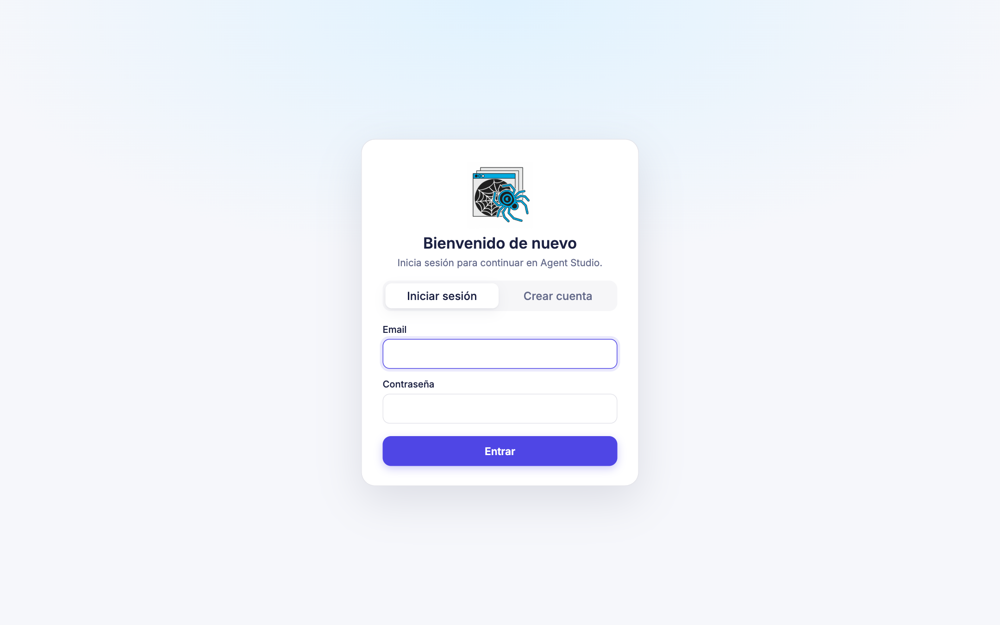 **Inicio de sesión** con usuarios en MariaDB | 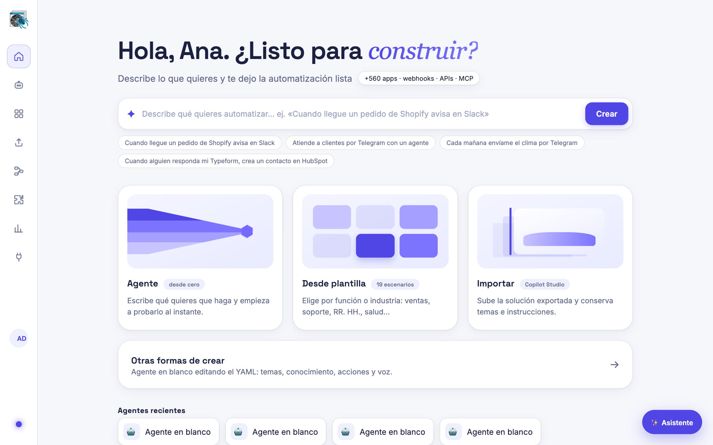 **Inicio**: describe lo que quieres automatizar |
| 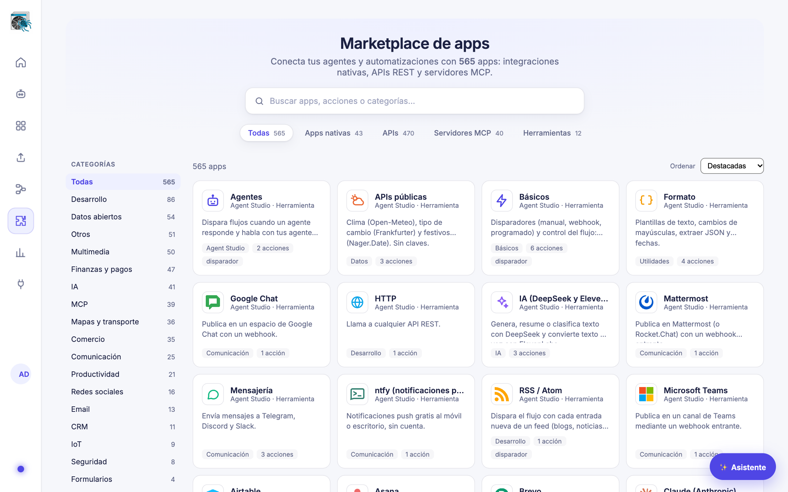 **Marketplace** de 565 apps con sus logos | 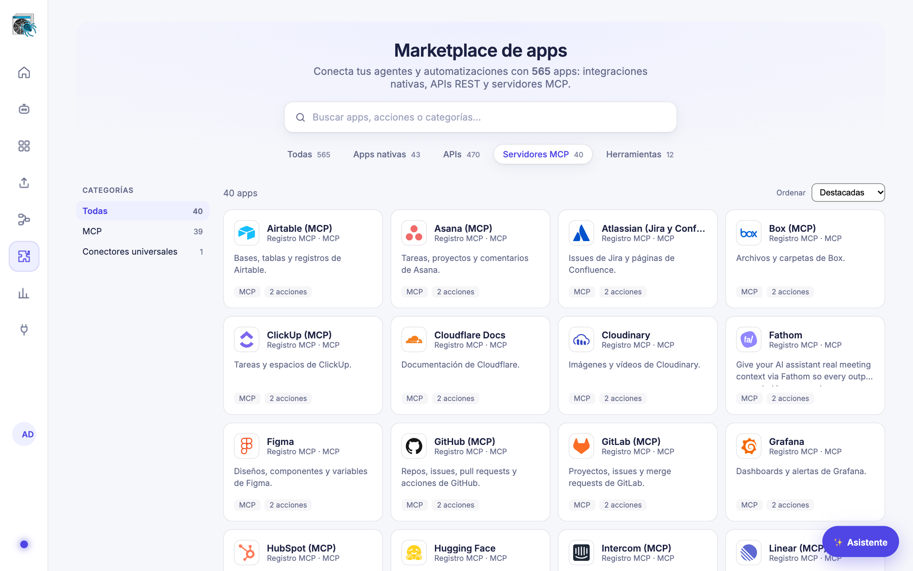 **Servidores MCP** oficiales |
| 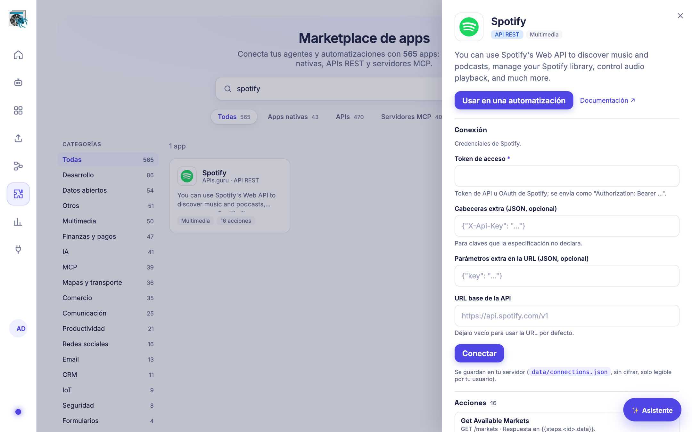 **Detalle de una app**: acciones y conexión | 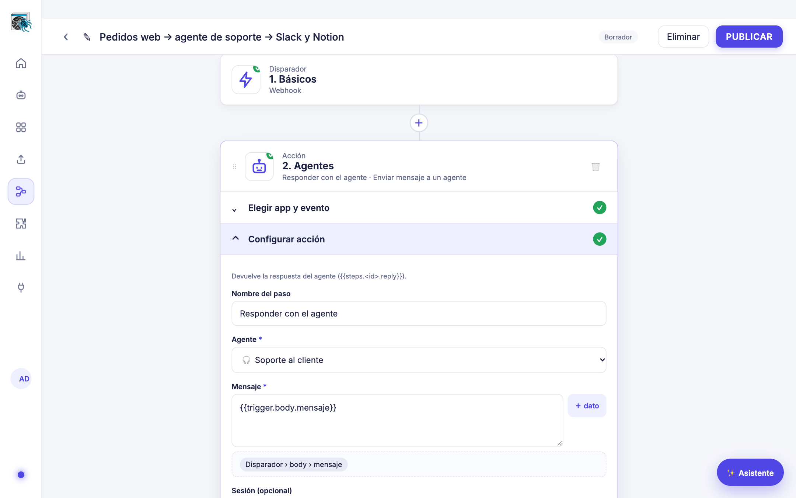 **Editor de automatizaciones** paso a paso |
| 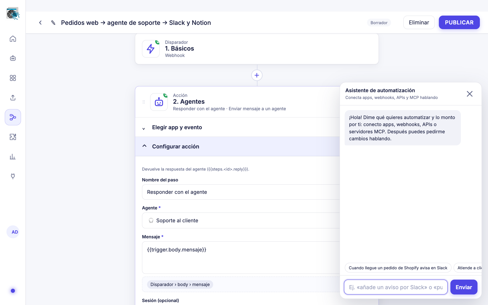 **Asistente** que crea y cambia flujos hablando | 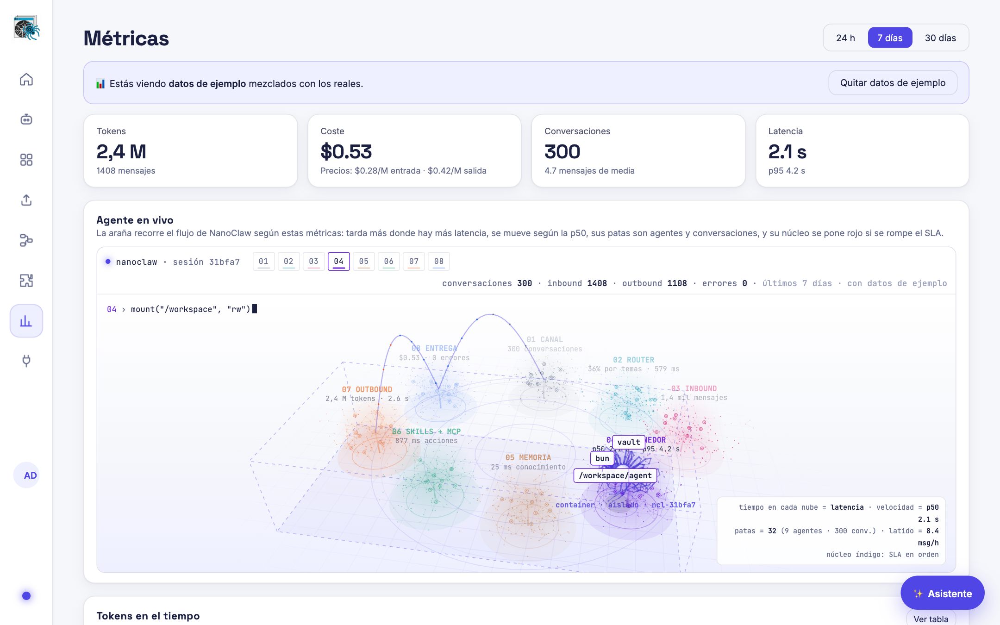 **Métricas** con el agente en vivo (datos de ejemplo) |
| 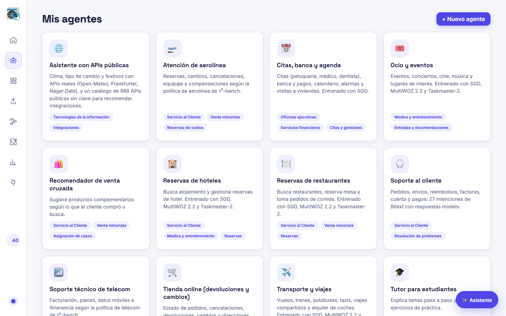 **Agentes** generados desde datasets abiertos | 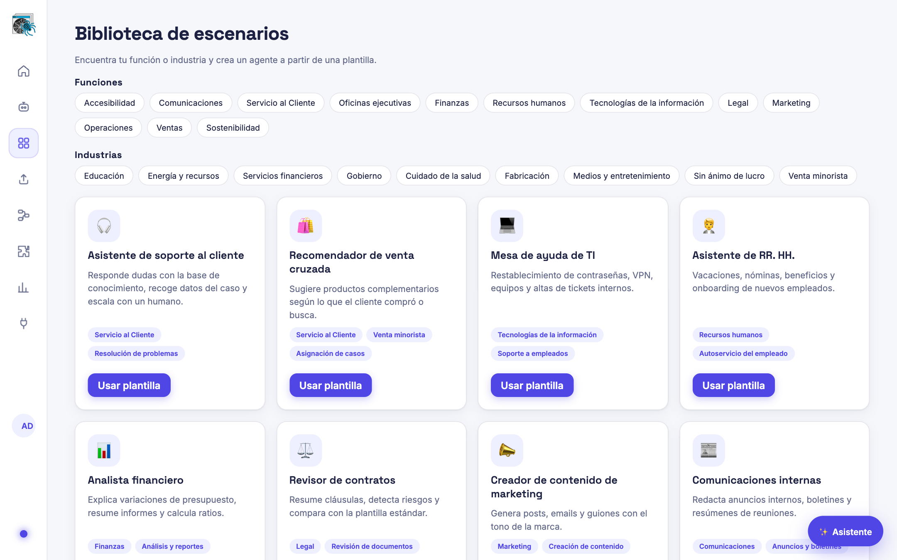 **Biblioteca de escenarios** |
| 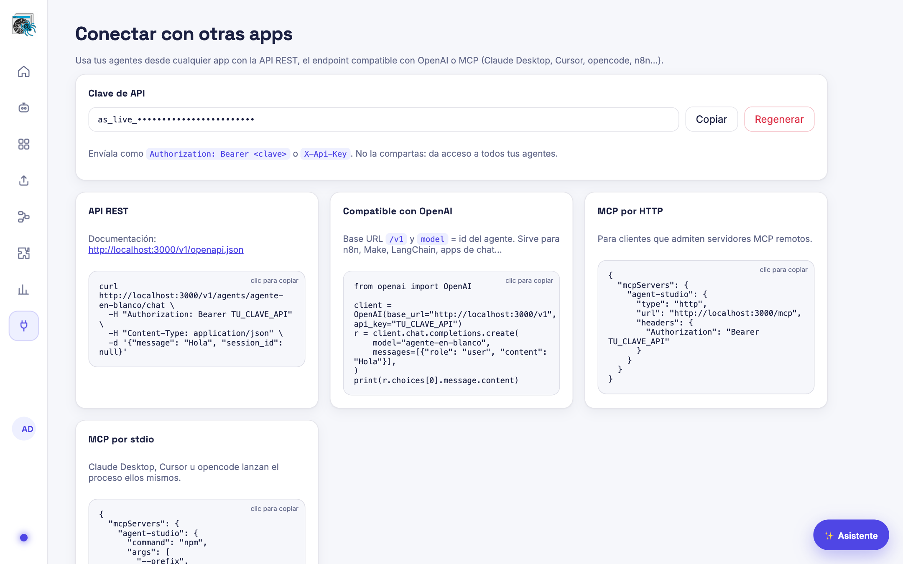 **Conectar** por API REST, OpenAI o MCP | |

## Arranque

```bash
cp .env.example .env   # pon DEEPSEEK_API_KEY y/o QWEN_API_KEY, ELEVENLABS_API_KEY y los datos de MariaDB (DB_*)
npm install
npm run build:datasets # opcional: descarga los datasets y regenera el conocimiento de los agentes
npm run migrate:tenancy # solo si vienes de una versión sin empresas: respalda y migra tus datos a la empresa Default
npm start              # http://localhost:3000 (la primera cuenta será Propietaria de la empresa Default y superadmin)
npm test               # pruebas (las de permisos y empresas usan MariaDB: ver test/_helpers.ts)
```

## Qué incluye

| Copilot Studio | Aquí |
|---|---|
| Modelo GPT | DeepSeek, Qwen, OpenRouter, Groq, Ollama o cualquier API compatible con OpenAI, con un modelo por tarea y respaldo (ver «Varios proveedores de LLM») |
| Temas y disparadores | `topics` con pasos: `message`, `question`, `condition`, `set`, `action`, `generate`, `goto`, `end` |
| Conocimiento | `knowledge` (texto, archivos, URLs) con búsqueda BM25 |
| Acciones / Power Automate | `actions`: llamadas HTTP que el LLM usa como herramientas |
| Voz | ElevenLabs TTS + Scribe (voz a texto) |
| Biblioteca de escenarios | `catalog/catalog.yaml`, organizada por función e industria |

## Migrar tus agentes de Copilot Studio

1. En Copilot Studio, añade el agente a una **Solución**.
2. En Power Apps → **Soluciones → Exportar** (no administrada).
3. En la interfaz, ve a **Importar de Copilot Studio** y sube el .zip; o desde la terminal: `npm run import -- Solucion.zip`.

Lo que no se puede traducir automáticamente (flujos de Power Automate, SharePoint, tarjetas adaptativas) sale en el informe como "Revisar" y se marca en el agente con `[IMPORT]`. El YAML original de cada componente se guarda en `agents/<empresa>/<id>/import/`. Por línea de comandos: `npm run import -- solucion.zip --tenant <id>` (sin `--tenant`, en la empresa Default).

## Varios proveedores de LLM (ahorro de tokens)

Agent Studio habla con cualquier proveedor con API compatible con OpenAI. Vienen preparados **DeepSeek**, **Qwen** (Alibaba Cloud Model Studio, endpoint internacional), **OpenRouter**, **Groq** y **Ollama** (local); otros se añaden con `LLM_PROVIDERS`. Un modelo se escribe `proveedor:modelo` (`qwen:qwen-flash`, `deepseek:deepseek-v4-pro`).

Para gastar menos:

- **Un modelo por tarea.** `LLM_MODEL` responde en las conversaciones, `LLM_MODEL_CLASSIFY` elige el tema y clasifica textos (por defecto `auto`: el modelo con precio más barato que tenga clave) y `LLM_MODEL_FLOWS` atiende los flujos y el asistente. Cada agente puede fijar el suyo en el YAML: `model: qwen:qwen-plus`.
- **Respaldo.** Si un proveedor falla (límite de uso, caída, clave rechazada), se prueba el siguiente de `LLM_FALLBACKS`. Un error de la propia petición (400) no se reintenta.
- **Coste por modelo.** Cada llamada guarda tokens (también los de caché) y coste por `proveedor:modelo`, tanto en conversaciones como en flujos y en el asistente. En **Métricas**, la tabla «Coste por modelo» los compara.
- **Tú das el servicio.** Las claves de IA son tuyas: las pones como superadmin en **Empresas y planes → Ajustes** (cifradas; mandan sobre el `.env`, que queda como alternativa) y las usan todas tus empresas. Tus clientes no ponen claves. Ahí mismo eliges el modelo de cada tarea y el respaldo, y pruebas cada clave.

Precios de serie (USD por millón de tokens, consultados el 31/10/2026 en las páginas oficiales; revísalos, cambian a menudo):

| Modelo | Entrada | Entrada en caché | Salida |
|---|---|---|---|
| `deepseek:deepseek-flash` | 0,30 | 0,006 | 1,20 |
| `deepseek:deepseek-v4-pro` | 1,32 | 0,044 | 3,96 |
| `qwen:qwen-flash` | 0,05 | — | 0,40 |
| `qwen:qwen-plus` | 0,40 | — | 1,20 |
| `qwen:qwen-max` | 1,60 | — | 6,40 |

DeepSeek: tarifa de horas punta (fuera de punta, la mitad). Qwen: tramo de hasta 256K tokens de entrada, sin modo «thinking»; no publica el precio con caché, así que se cuenta sin descuento. Ajusta o añade precios con `LLM_PRICES`; un modelo sin precio cuenta 0 y no entra en la elección automática del más barato. Las variables `PRICE_*_PER_M` de antes siguen valiendo para DeepSeek y `DEEPSEEK_MODEL` para el modelo por defecto.

## Idioma y cobro de cada cliente (superadmin)

En **Empresas y planes → Empresas**, para cada cliente eliges:

- **Idioma: español o inglés.** Cambia la interfaz para sus usuarios, el idioma en que responden sus agentes (los que no fijan `language` en su YAML) y el de sus correos de invitación. La traducción de la interfaz está en `public/i18n.js`; no se traducen el contenido que escribe cada empresa, las plantillas de agentes ni las descripciones de las apps del marketplace.
- **Forma de cobro: Stripe o Mercado Pago.** Con **Cobros** creas un enlace de pago (Stripe Checkout o preferencia de Mercado Pago) por el importe que indiques, prellenado con el cobro estimado del mes (conversaciones × precio del plan). El Propietario de la empresa lo ve en **Configuración → Facturación** y paga ahí; con **Comprobar pago** se consulta al proveedor si ya se pagó, o lo marcas a mano.

Las credenciales de Stripe (clave secreta) y Mercado Pago (access token), la moneda de cada uno y la página de vuelta tras pagar se ponen en **Empresas y planes → Ajustes**, cifradas. Son tus cuentas: tus clientes no configuran nada.

## Webs y tiendas de tus clientes (plantillas + marketplace)

Módulo **Web y tienda** (`web_store`, incluido en los planes Pro y Empresa; cada empresa lo activa en Configuración → Módulos).

- **Tú subes las plantillas** en **Empresas y planes → Plantillas web**: el HTML y la lista de campos que el cliente puede editar (texto, texto largo, imagen, enlace, color). Para cada plantilla decides **para qué clientes es**: por plan y por **tipo de negocio** (restaurante, tienda de ropa…, que le pones a cada empresa en Empresas). Sin plan ni tipo marcados, vale para todos. Cada cliente solo ve las suyas y su web es solo suya; si cambias el público, quien ya la usa la conserva. Con **Importar ejemplos** cargas las de `site-templates/` (ver su README para los marcadores `{{campo}}`, `{{#productos}}…{{/productos}}`, `{{comprar}}`, `{{carrito}}`). El HTML de las plantillas es tuyo y de confianza; lo que escribe cada cliente se escapa siempre y los enlaces solo pueden ser `http(s)`.
- **Tus clientes solo editan** en **Mi web**: eligen plantilla, rellenan sus campos (con vista previa en vivo y subida de imágenes), gestionan el **catálogo** (precio, existencias, imagen, visible u oculto), ven sus **pedidos** y publican. No tocan el HTML.
- **Su web** queda en `https://<tu-dominio>/s/<empresa>` y, si quieren, en **su propio dominio**: crean un CNAME a `PUBLIC_HOST` y la plataforma la sirve por la cabecera `Host`. Con Caddy, el certificado se emite solo y únicamente para dominios de webs publicadas:

  ```
  {
    on_demand_tls {
      ask http://localhost:3000/tls-allowed
    }
  }
  https:// {
    tls { on_demand }
    reverse_proxy localhost:3000
  }
  ```
- **Compra como marketplace**: el carrito y el pago los inyecta la plataforma en todas las webs (`public/site-shop.js`). Los precios se toman siempre del catálogo, se comprueban existencias y el dinero va a la cuenta **del cliente**; tú te quedas tu **comisión** (Ajustes → Marketplace, en %).
  - **Stripe Connect** (cargos con destino): con tu clave secreta de Stripe, el cliente pulsa «Conectar Stripe», completa el alta de Stripe y cada venta es una Checkout Session con `transfer_data[destination]` = su cuenta y `application_fee_amount` = tu comisión. Webhook opcional `…/webhooks/stripe` (`checkout.session.completed`, `account.updated`) con su secreto `whsec_…`.
  - **Mercado Pago Marketplace**: crea una aplicación en Mercado Pago Developers, registra la URL de redirección que ves en Ajustes (`…/oauth/mercadopago/callback`) y guarda su Client ID y Client secret. El cliente pulsa «Conectar Mercado Pago», autoriza con su cuenta y cada preferencia se crea con su token y `marketplace_fee` = tu comisión. Los tokens se guardan cifrados con la clave de su empresa y se renuevan solos.
  - Un pedido solo se marca pagado tras consultar al proveedor (a la vuelta del comprador o por el aviso), una sola vez, y entonces se descuentan las existencias.

## Modo orquestado: Jev + Qwen/DeepSeek + Claude Code

Con **Empresas y planes → Ajustes → Cómo responden los agentes = Orquestado** (o `AGENT_BACKEND=orquestado`), cada modelo hace lo que mejor y más barato hace:

1. **[Jev](https://docs.typesafe.ai) decide** ($0,042 por millón de tokens de entrada, salida gratis, menos de medio segundo). Para cada mensaje, una decisión tipada: ¿se responde con un mensaje o es una tarea compleja? También elige el tema guiado del agente y, en los flujos, hace los pasos «Clasificar texto» y «¿Se cumple? (sí/no)». Jev no redacta texto. Si duda (confianza por debajo de `JEV_MIN_CONFIDENCE`), no actúa y decide el orquestador.
2. **Qwen o DeepSeek orquestan.** Responden lo sencillo con las herramientas del agente y, lo que no pueden hacer, lo delegan en Claude Code con la herramienta `delegar_a_claude_code`.
3. **Claude Code hace lo complejo:** lo que Jev marca como complejo o lo que le delega el orquestador. Dentro de Claude Code, Jev (`jev_decidir`) y el modelo rápido (`modelo_rapido`, Qwen/DeepSeek) son herramientas para las operaciones repetitivas: clasificar, puntuar o comprobar muchos elementos, resumir o traducir.

Jev es opcional: sin su clave decide el propio orquestador. Si Claude Code falla, responde el orquestador. En **Métricas**, «Coste por modelo» separa lo que gasta cada uno (`typesafe:jev-…`, `qwen:…`, `deepseek:…`, `claude-code:…`). La clave de TypeSafe se pone en **Ajustes → Claves de IA**, con botón para probarla.

## Backend Claude Code

Con `AGENT_BACKEND=claude-code` en `.env`, las respuestas libres de los agentes las da **Claude Code**, usado como librería con el [Claude Agent SDK](https://code.claude.com/docs/en/agent-sdk) (`@anthropic-ai/claude-agent-sdk`). Agent Studio sigue siendo el editor y el chat de pruebas:

- Los **temas guiados** (preguntas, opciones, condiciones) se ejecutan en Agent Studio.
- Las **respuestas libres** las genera Claude Code. Cada conversación continúa su propia sesión de Claude Code.
- Cada agente tiene su espacio en `data/tenants/<empresa>/claude-code/<agente>/CLAUDE.md` (instrucciones, temas, conocimiento y acciones), generado a partir del YAML. Se regenera solo cuando cambias el agente (y entonces la conversación empieza de nuevo); edítalo en Agent Studio, no allí.
- Las **acciones HTTP** del agente y las herramientas de los **módulos de negocio activos** le llegan como un servidor MCP en proceso, con las mismas reglas de permisos y auditoría que el backend directo. Los servidores MCP del YAML (`mcpServers`) también se le pasan; los de stdio, solo en la empresa Default.
- Las **herramientas integradas** de Claude Code (Bash, Read, Write, Edit…) están **desactivadas**: el agente atiende a usuarios, no trabaja en el servidor. Con `CLAUDE_CODE_TOOLS=WebSearch,WebFetch` puedes permitir algunas, solo para la empresa Default.
- El coste y los tokens que informa Claude Code se apuntan en las **Métricas** de cada turno.

Requisitos: la clave de Anthropic en **Empresas y planes → Ajustes** o `ANTHROPIC_API_KEY` en `.env` (o un login de `claude`). Modelo: `CLAUDE_CODE_MODEL` (por defecto `claude-opus-5-5`); un agente con `model: claude-…` en su YAML usa ese. Ajustes opcionales: `CLAUDE_CODE_EFFORT`, `CLAUDE_CODE_MAX_TURNS` y `CLAUDE_CODE_TIMEOUT_MS`.

Sustituye al antiguo backend NanoClaw: `AGENT_BACKEND=nanoclaw` se trata como `claude-code` (con un aviso) y las variables `NANOCLAW_*` ya no se usan.

## Conectar con otras apps (API REST y MCP)

Las claves de API son **por empresa** y se crean en **Configuración → Claves de API** con sus *scopes* (los permisos que tendrá la clave; nunca más que los tuyos). Se ven una sola vez y se pueden revocar. Envíala como `Authorization: Bearer <clave>` o `X-Api-Key`. La pantalla **Conectar** tiene ejemplos listos para copiar. `AGENT_STUDIO_API_KEY` (y, sin MariaDB, `data/api-key`) siguen funcionando como clave de la empresa Default con todos los permisos. Para `npm run mcp` (stdio) define `AGENT_STUDIO_MCP_KEY` con una clave de tu empresa.

| Qué | Dónde |
|---|---|
| API REST | `/v1/agents`, `/v1/agents/{id}/chat`, `/v1/templates`, `/v1/tts`… — documentada en `/v1/openapi.json` |
| Compatible con OpenAI | `POST /v1/chat/completions` con `model` = id del agente (la sesión va en `X-Session-Id` o `user`) |
| MCP por HTTP | `POST /mcp` (Streamable HTTP, sin estado) |
| MCP por stdio | `npm run mcp` |

Herramientas MCP: `list_agents`, `get_agent`, `chat_with_agent`, `create_agent`, `list_templates`, `create_agent_from_template`, `reset_conversation`.

La API interna `/api/*` es solo para la interfaz local y no lleva autenticación: si publicas el servidor, expón únicamente `/v1` y `/mcp`.

## Métricas

Cada mensaje se registra en `data/tenants/<empresa>/metrics/events.jsonl`: tokens (entrada, caché, salida), coste estimado, latencia de cada paso (clasificar, conocimiento, modelo, acciones, Claude Code, voz) y ruta (saludo, tema, respuesta libre, Claude Code), además del canal (interfaz, API, OpenAI, MCP).

La pantalla **Métricas** muestra: tokens en el tiempo por agente, coste acumulado del mes frente al presupuesto, coste por agente, latencia por paso y coste por resultado de cada conversación. Cada gráfica tiene vista de tabla. Los mismos datos están en `GET /v1/metrics?range=24h|7d|30d`.

Los precios y el presupuesto se configuran en `.env` (`PRICE_INPUT_PER_M`, `PRICE_OUTPUT_PER_M`, `MONTHLY_BUDGET_USD`…). Con Claude Code se usan el coste y los tokens que informa el propio SDK.

## Agente en vivo (visualización)

El recorrido de un mensaje, dibujado con la arquitectura de NanoClaw (canal → router → inbound.db → contenedor → memoria → skills/MCP → outbound.db → entrega) se dibuja en 3D en `public/nanoclaw-flow.html` (canvas 2D con proyección en perspectiva propia, sin librerías): suelo holográfico, nubes como volúmenes flotantes, la caja del contenedor en alambre y una araña cuyas patas se resuelven con FABRIK en 3D. Arrastra para girar la cámara; haz clic en el suelo para mover a la araña.

En **Métricas** está la tarjeta **Agente en vivo**: la misma araña, pero guiada por las métricas del periodo elegido. El tiempo que pasa en cada nube es proporcional a la latencia de esa fase; su velocidad, a la latencia p50; sus patas, a los agentes activos y las conversaciones; su latido, a los mensajes por hora; y el núcleo se pone rojo si se rompe el SLA (proyección por encima del presupuesto, p95 > 8 s o errores). Cada nube muestra su métrica (conversaciones, % resuelto por temas, tokens, coste…).

## Automatizaciones y módulos

**Automatizaciones** es un editor de flujos de arrastrar y soltar: un disparador (manual, webhook, programado, "un agente responde" o sondeo) y una serie de acciones. Las salidas de cada paso se usan en los siguientes con `{{trigger.…}}` y `{{steps.<id>.…}}`; el botón **Probar** muestra el resultado de cada paso y las variables disponibles.

- Webhooks públicos: `POST /hooks/<empresa>/<id-del-flujo>` (con `?token=` si el disparador tiene secreto). La ruta antigua `/hooks/<id>` sigue funcionando solo para la empresa Default y responde con la cabecera `Deprecation`.
- Ejecutar por API: `POST /v1/flows/<id>/run` con una clave que tenga `flows.manage`.
- Historial: `data/tenants/<empresa>/flows/runs/<id>.jsonl`.

**Módulos** integrados en `modules/`: básicos (filtro, espera, variables), HTTP, agentes, IA (texto con el modelo configurado y voz con ElevenLabs), formato, mensajería (Telegram, Discord, Slack) y APIs públicas (clima, divisas, festivos). Los de la comunidad van en `modules-community/` y se instalan desde la pantalla Módulos pegando la URL de un archivo. Cómo crear uno: [MODULES.md](MODULES.md).

La forma de los módulos se inspira en las apps de [Automatisch](https://github.com/automatisch/automatisch), pero no incluye su código (AGPL-3.0): es una implementación propia.

## Agentes generados desde datasets

`npm run build:datasets` crea 10 agentes a partir de Schema-Guided Dialogue, MultiWOZ 2.2, Taskmaster-2, τ²-bench, Bitext y public-apis (temas guiados, frases reales, conversaciones de ejemplo, políticas y acciones con APIs sin clave). Fuentes y licencias en `agents/1/<id>/knowledge/fuentes.md`.

## Usuarios e inicio de sesión (MariaDB)

- Se activa al definir `DB_HOST` en `.env` (ver `.env.example`). Al arrancar aplica las migraciones versionadas (`schema_migrations`) en la base `agent_studio`.
- **La primera cuenta que se registra es Propietaria de la empresa Default y superadmin de la plataforma.** Las demás entran con una invitación. Con `AUTH_ALLOW_SIGNUP=false` solo se puede crear esa primera cuenta o registrarse con una invitación. Con `TENANT_SELF_SIGNUP=true`, quien se registra sin invitación crea su propia empresa.
- Contraseñas con scrypt y sal por usuario. La sesión es una cookie `HttpOnly; SameSite=Lax` de 30 días, y en la base solo se guarda el SHA-256 del token. Hay bloqueo de 15 min tras 8 intentos fallidos por email e IP, y se rechazan las peticiones que cambian datos desde otro origen. Si sirves la app por HTTPS, pon `COOKIE_SECURE=true`.
- Toda la API de la interfaz (`/api/*`) pide sesión, y cada ruta, un permiso (ver más abajo). La API pública `/v1` y `/mcp` usa claves de API por empresa, y los webhooks `/hooks/*` su token opcional.
- Usuarios, roles e invitaciones se gestionan desde **Configuración**. Todavía no hay recuperación de contraseña por email.
- Sin `DB_HOST` la app funciona como antes: sin login, una sola empresa (Default) y todos los permisos; los módulos de negocio se ven en solo lectura.

## Empresas, roles y módulos activables (multi-tenant)

Una sola instalación sirve a varias empresas con sus datos totalmente aislados. Cada empresa tiene sus agentes (`agents/<empresa>/`), automatizaciones, conexiones cifradas, métricas, claves de API y auditoría (`data/tenants/<empresa>/`).

**Quién gestiona qué**

- **Superadmin de plataforma** (vista **Empresas y planes**): crea y suspende empresas, edita los planes (límites, precio por conversación y módulos incluidos), ve el consumo de cada empresa y puede **entrar como soporte** (con permisos de Admin; queda en la auditoría de la empresa).
- **Admin de empresa** (vista **Configuración**): activa los módulos que permite su plan, invita usuarios, crea roles y claves de API y conecta apps.

**Roles del sistema** (plantillas de solo lectura; se pueden clonar): *Propietario* (todo, incluida facturación y eliminar la empresa), *Admin* (todo menos eso), *Operador* (usa los módulos activos, sin tocar configuración, módulos ni usuarios) y *Solo lectura* (`*.read`). Los permisos siguen el formato `modulo.recurso.accion` (`crm.contacts.write`) más los de plataforma (`tenant.users.manage`, `tenant.features.manage`, `agents.manage`, `flows.manage`, `metrics.read`, `audit.read`…). Nadie puede dar permisos que no tiene, y siempre queda al menos un Propietario.

**Módulos activables** (`src/features/registry.ts`): CRM, bandeja compartida, inventario, pedidos y pagos, carritos abandonados, catálogo en el chat, agenda, llamadas, SSO con Microsoft, evaluaciones, CFDI, widget web y facturación por uso; además, auditoría y credenciales cifradas, que no se pueden desactivar. Una función se puede usar solo si:

```
Plan de la empresa → ¿incluido?  ·  Empresa → ¿activado?  ·  Rol → ¿tiene el permiso?  ·  Dependencias → ¿activas y con sus conexiones?
```

Lo decide una sola función, `can(ctx, { feature, permission })` (`src/authz/can.ts`), que se aplica en `/api` (cada ruta declara su permiso), `/v1` y `/mcp` (scopes de la clave), las herramientas del agente (el LLM solo ve las de módulos activos y las llamadas bloqueadas se rechazan y auditan), las automatizaciones (los pasos de módulos inactivos se ocultan, el flujo falla sin ejecutar nada y los programados quedan en pausa) y los webhooks (403 y auditoría). Desactivar un módulo **nunca borra datos**. La interfaz oculta lo que no se puede usar, pero la seguridad se valida siempre en el servidor. Cómo añadir un módulo nuevo: [FEATURES.md](FEATURES.md).

**Auditoría** (Configuración → Auditoría): cambios de módulos, roles, usuarios, conexiones y claves, inicios de sesión, modo soporte, herramientas y webhooks bloqueados. Es de solo lectura incluso para el Propietario (la base lo impide con triggers si el usuario de MariaDB tiene permiso `TRIGGER`). Se filtra por actor, acción y fecha y se exporta a CSV.

**Migrar una instalación existente**: `npm run migrate:tenancy`. Es repetible y respalda antes de mover (`data/backups/tenancy-<fecha>/`): crea la empresa Default (id 1), hace Propietario y superadmin al administrador actual (el resto de cuentas pasan a Admin de Default), mueve `data/` y `agents/` a sus carpetas por empresa, cifra `connections.json` y convierte `data/api-key` en una clave de API de Default.

**Seguridad entre empresas**: además del aislamiento de datos, un agente o flujo solo ve las variables `FLOW_*` del `.env` si es de la empresa Default, los servidores MCP por stdio (que ejecutan programas en el servidor) solo se permiten en Default (`MCP_STDIO_ALL_TENANTS=true` para cambiarlo) e instalar módulos de la comunidad es cosa del superadmin.

## Conectar con más apps

- **51 conectores nativos** (`modules/apps/index.ts`): Slack, Discord, Telegram, WhatsApp Business, Twilio, Teams, Google Chat, Mattermost, ntfy, Pushover, Gmail, Resend, SendGrid, Mailgun, Postmark, Brevo, Mailchimp, Notion, Airtable, Google Sheets, Google Calendar, Todoist, Trello, Asana, ClickUp, monday.com, Jira, Linear, GitHub, GitLab, Supabase, RSS, HubSpot, Pipedrive, Salesforce, Zendesk, Freshdesk, Intercom, Stripe, Shopify, WooCommerce, Mercado Pago, Facturama (CFDI), Typeform, WordPress, Claude, cualquier LLM compatible con OpenAI, Gemini y DeepL. Cada uno es una definición declarativa (`src/modules/http-app.ts`): añadir una app son unas líneas.
- **Conexiones**: cada flujo tiene el paso «Elegir conexión»; las credenciales se guardan por empresa en `data/tenants/<empresa>/connections.json`, **cifradas con AES-256-GCM** y una clave derivada por empresa de `ENCRYPTION_KEY`, y nunca se devuelven completas a la interfaz. Las variables `FLOW_<APP>_<CAMPO>` del `.env` solo valen para la empresa Default.
- **MCP**: el módulo «MCP (cualquier servidor)» lista y llama herramientas de cualquier servidor MCP (HTTP, SSE o stdio). Los agentes también pueden usarlos: añade `mcpServers: [{ name, url, headers }]` a su YAML y sus herramientas estarán disponibles en las respuestas del modelo.
- **OpenAPI**: el módulo «Cualquier API (OpenAPI)» llama a cualquier operación de una especificación OpenAPI/Swagger.
- **Marketplace de 565 apps** (vista «Apps», inspirada en el marketplace de Dify; diseño propio, sin código de Dify): pestañas por tipo, categorías con contadores, búsqueda, tarjetas con el logo real de cada app y un panel con sus acciones, la conexión y «Usar en una automatización».
  - **469 APIs REST** generadas desde [APIs.guru](https://apis.guru) (CC0): hasta 15 operaciones por API con sus parámetros, la autenticación que declara la especificación y la acción «Llamar a cualquier endpoint». Solo se incluyen APIs cuyo servidor respondía al generar el catálogo. Ojo: muchas especificaciones son antiguas, así que algunas rutas pueden haber cambiado, y algunas APIs piden una clave que no declaran (para eso están los campos «Cabeceras extra» y «Parámetros extra» de la conexión). Los nombres de acciones y descripciones vienen en inglés, como en la especificación.
  - **39 servidores MCP oficiales** (Notion, Linear, Atlassian, Asana, Stripe, PayPal, GitHub, Figma, Canva, Vercel, Supabase, HubSpot, Zapier…), con «Ver herramientas» y «Usar una herramienta». Solo se incluyen los que respondían al generar. Muchos usan OAuth en el navegador, que Agent Studio todavía no gestiona: si el servidor da un token personal, se pega en la conexión.
  - **Logos**: [Simple Icons](https://simpleicons.org) (CC0) en el color de la marca; si la marca no está, el logo de la especificación o el favicon de su dominio, guardados en `public/logos/`. Las marcas pertenecen a sus dueños y solo identifican la app.
  - Se regenera con `npm run build:catalog` (descarga ~670 especificaciones; usa Simple Icons descomprimido en `/tmp/si/package` o en `SI_DIR`). Las apps hechas a mano en `modules/apps` tienen prioridad sobre las generadas.

## Asistente de automatización y onboarding

En **Inicio**, escribe lo que quieres («Cuando llegue un pedido de Shopify avisa en Slack») y Agent Studio crea el flujo —y un agente si la petición lo describe— y te lleva al editor. El botón **✨ Asistente** abre un chat en cualquier pantalla para seguir ajustando hablando: «añade un correo», «quita el paso 3», «cámbialo a cada hora», «conecta https://…/mcp», «publícalo». Con algún proveedor de LLM configurado el plan lo hace el modelo con el catálogo de módulos; sin él se usan reglas propias. Rutas: `POST /api/assistant/plan` y `POST /api/assistant/chat`.

## Créditos de datos

- Conocimiento de los agentes generado a partir de Taskmaster-2 (CC BY 4.0), Schema-Guided Dialogue / DSTC8 (CC BY-SA 4.0), MultiWOZ 2.2, τ²-bench, el dataset de soporte de Bitext en Hugging Face y public-apis. Revisa la licencia de cada uno antes de usarlo comercialmente.
- Catálogo de APIs: [APIs.guru](https://apis.guru) (CC0). Servidores MCP: [registro oficial de MCP](https://registry.modelcontextprotocol.io). Logos: [Simple Icons](https://simpleicons.org) (CC0); las marcas pertenecen a sus dueños.
- El diseño de automatizaciones se inspira en Zapier y Automatisch, y el del marketplace en Dify. No contiene código de ninguno de ellos.
